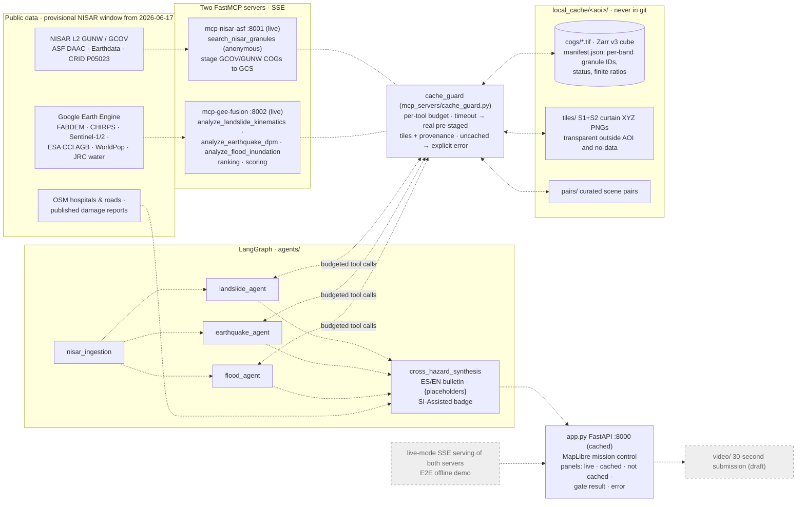
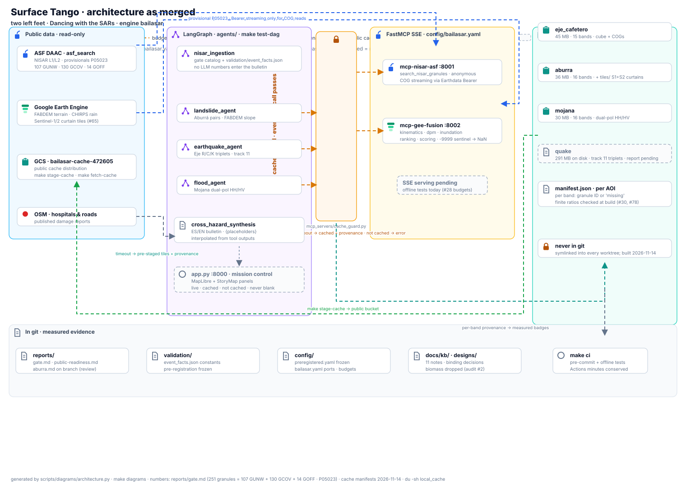
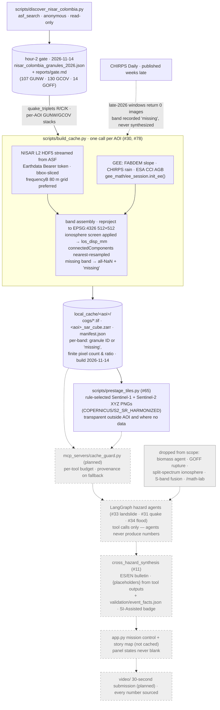
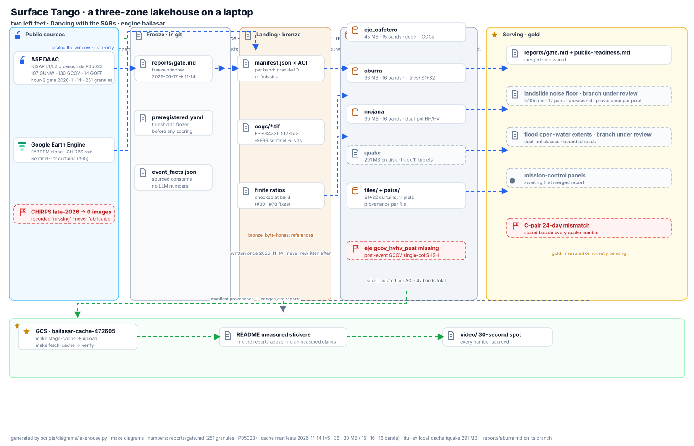
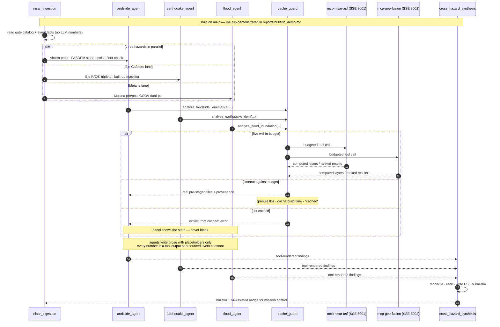

<div align="center">

# Surface Tango

### A NISAR L-band multi-agent observatory for cascading disasters in Colombia

**Which neighborhoods moved after the 2026-08-10 Eje Cafetero earthquake, which slopes in the Aburrá
Valley are creeping, and where did the La Mojana wetlands flood — measured from the first public
NISAR L-band data, with a ranked first-aid answer and no number without a source?**

[](.pre-commit-config.yaml)
[](https://www.conventionalcommits.org/en/v1.0.0/)
[](https://docs.astral.sh/uv/)
[](https://www.python.org/)
[](pyproject.toml)
[](https://github.com/astral-sh/ruff)
<br>
[](mcp_servers/)
[](agents/)
[](gee_math/ee_session.py)
[](https://nisar-docs.asf.alaska.edu/gunw/)
[](scripts/build_cache.py)
[](app.py)
<br>
[](reports/gate.md)
[](briefs/feat/data-cache-builder.md)
[](reports/tests.md)
[](reports/gate.md)
[](validation/ALLOWLIST.md)
[](validation/README.md#deviations)

<sub>Team **two left feet** · NASA Space Apps 2026 challenge "Dancing with the SARs" · Medellín, Colombia · private until the submission · agency names are attribution, never endorsement or logos</sub>

<sub>_Two left feet, one coordinated surface tango_ — 🔵 blue is the first pass, 🔴 vermilion the second · [brand guidelines](docs/brand/brand-guidelines.md)</sub>

</div>

---

> **Evidence rules.** No synthetic or fabricated data. Missing pixels and bands remain missing (NaN, shown as "no data"), never zero-filled. Measured results require the producing command, source granule or scene IDs, denominators and applicable intervals; estimates must be labelled. Agents write prose with `{placeholders}` filled from tool outputs. Only public data; no personal data or secrets. Pre-registration parameters live only in [config/preregistered.yaml](config/preregistered.yaml), **frozen** since 2026-11-15 (#130; blob `b4f9cb89910e78fa7ad9fd53a2a4b3fca437b438`, recorded in [validation/README.md](validation/README.md)). See [AGENTS.md](AGENTS.md).

## The problem, the answer, the impact

- **The problem.** Colombia's cascading disasters — an earthquake that primes landslides, rain that drives both — are read after the fact from single scenes. The first public NISAR L-band archive opened on 2026-06-17 (ASF DAAC), but nobody has time to pair interferograms over three cities, distinguish motion from ionosphere and decorrelation, and rank where first aid should go — with numbers that can be defended.
- **The answer.** A multi-agent observatory over three cascading-disaster lanes — Aburrá Valley landslides, Eje Cafetero earthquake damage, La Mojana/Caregato flooding — where two FastMCP servers wrapped by a budgeted cache_guard do the geospatial computation, three LangGraph hazard agents interrogate them, and a synthesis agent writes an ES/EN bulletin whose every number came from a tool output or a sourced event constant. Every panel answers **live · cached · not cached · gate result · error** — never blank.
- **The impact.** One honest, measured radar result understandable in a 30-second video; **a null verdict is a valid headline.** Pre-registered scoring compares the quake ranking against a population-only baseline, so the map has to beat geography itself to claim skill.

> **🌀 Epicenter highlight (why L-band).** The M7.4 epicenter — San José del Palmar, Chocó (USGS us6000tjl2) — sits in one of Earth's cloudiest, most remote regions, where optical and C-band go blind. NISAR L-band **covers it**: *(measured)* 96 granules with co-event interferograms on three tracks (`reports/quake_extended_aois.md`). The thesis, demonstrated at the epicenter itself. La Mojana flood is the ratified video headline (#102); this is the earthquake chapter's hook.

## What the data says so far (hour-2 gate, measured)

Window 2026-06-17 → 2026-11-14 (public NISAR record), search `scripts/discover_nisar_colombia.py` (ASF, anonymous, read-only). Full evidence: [reports/gate.md](reports/gate.md), saved catalog `nisar_colombia_granules_2026.json`.

| AOI (`config/bailasar.yaml`) | GUNW | GCOV | GOFF | Streams |
|---|---:|---:|---:|---|
| 1 · Aburrá (Medellín, Bello, Copacabana) | 20 | 24 | 3 | PR 38 · UR 9 |
| 2 · Eje Cafetero (Pereira, Armenia, Manizales) | 19 | 24 | 3 | PR 38 · UR 8 |
| 3 · La Mojana / Caregato | 68 | 82 | 8 | PR 134 · UR 24 |
| **total** | **107** | **130** | **14** | all provisional |

- **Quake R/C/K triplets exist on both tracks** (11 descending frame 86; 47 ascending frame 4): R and K 12-day baselines, **C spans 2026-08-10 at 24 days** — the Aug 1 / Aug 4 acquisitions are missing, so every quake number reports the mismatch next to it ("closest available, mismatch recorded"). IDs in `quake_triplets`.
- **Dual-pol flooding is open**: 78 DHDH (HH/HV) GCOVs over La Mojana; the post-event Eje Cafetero GCOV is single-pol `SHSH`, so its cross-pol band is honestly `missing`.
- All products are **provisional (PR/UR, CRID P05023)** — every view and the video carry PROVISIONAL. No validated products exist in the window.
- GUNW ionosphere screens are present and **applied by our pipeline** ([docs/kb/nisar-gunw-ionosphere-screen-applied.md](docs/kb/nisar-gunw-ionosphere-screen-applied.md)); CHIRPS rain windows arrive weeks late and stay `missing` rather than synthesized ([docs/kb/chirps-daily-publication-lag.md](docs/kb/chirps-daily-publication-lag.md)).

## Status

**Progress (2026-11-15, D = 2026-11-15 23:59 COT).** Phases 1–4 complete and on `main`: the frozen pre-registration, all three hazard pipelines (Aburrá double-calibrated null, La Mojana open-water headline + L-vs-C, quake damage proxy with E_C−E_K under frozen K), the MCP evidence tools, and the bilingual LangGraph bulletin that runs end to end. The go-public gate is nearly clear — secret scan green, Apache-2.0 set — leaving the owner-gated Phase 5: record the video, finalize the page, and flip to public before the deadline. Offline suite green; the full observatory is **live on Google Cloud** at http://136.119.19.137:8000 (mission control + API serving publicly); repo private.

States: **live** · **cached** · **not cached** · **planned** · **dropped**. No completed integration is claimed without evidence.

| Component | State | Issue / PR | Report |
|---|---|---|---|
| NISAR discovery gate (search script and saved catalog) | live | #23, #52 | [Gate report](reports/gate.md) |
| Real-data cache builder — COGs + Zarr v3 + provenance manifest (3 AOIs) | cached | #30, #78 | [Builder brief](briefs/feat/data-cache-builder.md) |
| Sentinel-1/2 curtain-slider tiles (3 AOIs, rule-selected scenes) | cached | #30, #65 | `local_cache/<aoi>/tiles/manifest.json` |
| Quake damage proxy (tracks 11 and 47; C/K **unsealed** after the freeze, #130; track 11 is post-event control only) | cached: frozen-K proxy contrast is inconclusive; serialized K evidence still uses the old pair pending #141 | #31, #64, #111, #161 | [DPM](reports/quake_dpm.md), [frozen-K interpretation](reports/quake_dpm_interpretation.md) |
| Release staging and cache download | re-staged after the frozen-K rebuild (#180): three AOIs, hazard evidence artifacts, recorded bulletin artifacts and the unsealed `quake/` zarrs (747 MB part + manifest, source commit recorded); public `make fetch-cache` after the release is published | #42, #67, #163 | [staging report](reports/cache_release_v2.md) |
| Go-public gate (#46) | secret scan **green** (full history, 0 real leaks, #156); license **Apache-2.0** set (#145); deployment **live** on Google Cloud (http://136.119.19.137:8000); owner actions remaining: flip repo to public, publish release | #46, #83, #156, #145 | [secret scan](reports/full_history_secret_scan.md) |
| MCP servers (`mcp-nisar-asf` :8001, `mcp-gee-fusion` :8002) with cache_guard | live SSE transport; hazard tools serve evidence envelopes from real cache artifacts; missing artifacts return `not cached`; quake artifacts still carry the old K pair pending #141 | #20, #103, #122, #127, #136 | [schema note](docs/kb/mcp-evidence-artifact-schema.md) |
| Bulletin placeholder + verified-event contract | live; the graph rendered the ES/EN bilingual bulletin end to end (every number tool-traced, SI-Assisted badge, withheld→"not available") | #21, #162 | [bulletin demo](reports/bulletin_demo.md) |
| LangGraph hazard graph + ES/EN bilingual bulletin | live: ingestion → hazard agents → checked bilingual synthesis over tool evidence; measured nulls render in the bulletin and UI; agents emit no numbers | #36, #151, #153, #162, #166 | [live run](reports/bulletin_demo.md) |
| LangSmith tracing of agent runs (project `surface-tango`) | wired; off until `LANGSMITH_API_KEY` is set | #95 | `agents/tracing.py` |
| Pre-registration and power check | **frozen** 2026-11-15 (#130), control pairs K re-chosen by the design date rule and re-frozen (#131, deviation 2; blob `36a90fa…`; track 11 K is a labelled post-event control); power check: **scorecard uninformative** (0 verified barrio labels); C/K statistics unsealed at the freeze (deviation 1 disclosed) | #25, #26, #102, #131 | [validation/README.md](validation/README.md) |
| First-aid ranking and scorecard | scoring fns + MCP wrappers merged; scorecard is a documented **null** (uninformative ground truth); E_C−E_K reported with frozen K (track 11 CI includes zero) | #18, #32, #96, #110, #161 | [quake interpretation](reports/quake_dpm_interpretation.md) |
| Neighborhood ground truth | researched; no complete barrio damage dataset; candidate boundaries not adopted | #24, #97 | [Source review and gaps](reports/ground_truth.md) |
| Aburrá landslide noise-floor test | cached: **no motion detected above 9.105 mm (17 pairs, provisional)**; keep-rule compared with stable-pixel false positives and a sign-flip null | #33, #155 | [reports/aburra.md](reports/aburra.md) |
| La Mojana open water per date (HH, 90 m, track 47 frame 5, 10 usable dates) | cached | #34 | [reports/mojana.md](reports/mojana.md) |
| La Mojana L/C open-water comparison | cached: per-date comparison with an uncalibrated Sentinel-1 cut; no breach attribution | #160 | [reports/mojana_lvsc.md](reports/mojana_lvsc.md) |
| La Mojana change classes (dual-pol) | not cached: degenerate (driest-date rule picked 2026-10-27 with 1 valid pixel; rule needs a minimum valid-pixel count) | #34 | [reports/mojana.md](reports/mojana.md#baseline) |
| Local Zarr tile server | not cached | #22 | shared cube + manifest required |
| Mission-control UI, curtain slider and story map | cached (offline, opens on La Mojana; numbers parsed from the reports via `/api/pitch-facts`; quake panel state derives from the manifest since #166) | #22, #37 | [frontend status](status/frontend-video.md) |
| Submission video (30 s) | silent draft cut from `video/assemble.py`; voice-over pending; **headline ratified: La Mojana flood** | #39, #43, #102 | [storyboard](video/storyboard.md), [video README](video/README.md) |
| Biomass agent · GOFF rupture · split-spectrum ionosphere · S-band fusion · `/math-lab` | dropped | #41, #55, #56 | — |

## Architecture

Software architecture as merged on `main` — what runs today. Grey dotted boxes are the pieces not finished yet (the final video cut and the end-to-end live demo), per the Status table.



- **Agents route, tools compute:** numeric bulletin content comes only from deterministic tool outputs or sourced event constants in [validation/event_facts.json](validation/event_facts.json). LLM text interpolates `{placeholders}`.
- **Cache guard:** the fallback serves only real pre-staged tiles with provenance, or an explicit "not cached" error. [config/bailasar.yaml](config/bailasar.yaml) records the measured `search_nisar_granules` and `analyze_flood_inundation` breaker budgets, documented in [reports/tool_latency.md](reports/tool_latency.md); the other tools still use the default budget, an estimate pending measurement (#28).
- Frozen thresholds, ranking parameters and pair choices live only in [config/preregistered.yaml](config/preregistered.yaml) (frozen, #130); operational settings in [config/bailasar.yaml](config/bailasar.yaml). Design and binding decisions: [docs/designs/bailasar.md](docs/designs/bailasar.md).

The same system as an animated SVG, generated by [`scripts/diagrams/architecture.py`](scripts/diagrams/architecture.py) with `make diagrams` (flows animate; `prefers-reduced-motion` stops them):

[](docs/diagrams/architecture.svg)

It shows:

- the two FastMCP SSE servers and their ports exactly as [config/bailasar.yaml](config/bailasar.yaml) declares them;
- the `cache_guard` column every tool call passes, with its three outcomes: live within budget · timeout → cached tiles with provenance · not cached → explicit error;
- the git-ignored `local_cache/` zones with their measured sizes, and grey-dashed nodes for what is not built yet (matching the status table).

## Data flow

From public granule to bulletin, with the file names that do each step. Grey boxes are out of scope (dropped) or pending.



The cache as a three-zone lakehouse on a laptop, generated by [`scripts/diagrams/lakehouse.py`](scripts/diagrams/lakehouse.py) with `make diagrams`:

[](docs/diagrams/lakehouse.svg)

- **Bronze** is the per-AOI `manifest.json`: per band a granule ID or an honest `missing`, written once on 2026-11-14 and never rewritten after.
- **Silver** is the curated cache with its measured sizes — eje 45 MB · aburra 36 MB · mojana 30 MB · quake 291 MB on disk — plus the curtain tiles and pairs.
- **Gold** is the measured reports and panels; what is still under review on a branch is grey-dashed, and recorded gaps (late CHIRPS windows, the single-pol post-event GCOV, the C-pair 24-day mismatch) are red-dashed — recorded, never fabricated.

## Agent orchestration

How a run flows through the graph and the cache_guard's three outcomes (sequence):



## Results

- **Hour-2 gate** *(measured)*: [reports/gate.md](reports/gate.md) — 251 granules, quake triplets on both tracks, C-baseline mismatch recorded.
- **Real-data cache** *(measured)*: [builder brief](briefs/feat/data-cache-builder.md) — Eje 45 MB / 15 bands, Aburrá 36 MB / 16, Mojana 30 MB / 16; every band carries a granule ID or `missing` (CHIRPS ×3 missing: publication lag; Eje `gcov_hvhv_post` missing: post-event GCOV is single-pol).
- **Curtain tiles** *(measured)*: `local_cache/<aoi>/tiles/manifest.json` — rule-selected S1/S2 scenes per AOI (#65).
- **Tool latency** *(measured, n=10 per tool, owner run of `mcp_servers/tool_latency.py`)*: `search_nisar_granules` (p95 2.735 s incl. cold call → 3.24 s) and `analyze_flood_inundation` (p95 0.007 s → 0.51 s) are budgeted; the landslide and quake analysis tools and the staging tools still use the default pending measurement — see [reports/tool_latency.md](reports/tool_latency.md).
- The quake scorecard is [uninformative](validation/README.md#power-check-and-headline-plan-02-03-25); Aburrá has a [calibrated null](reports/aburra.md#verdict); La Mojana's [change classes](reports/mojana.md#baseline) lack a valid dry baseline. The end-to-end offline demo remains pending.
- **La Mojana headline** *(measured, PROVISIONAL)*: open water per date (e.g. 2026-06-17: 4,486.59 ha, 5,539/197,758 valid px) and the L-band-vs-C-band comparison — Sentinel-1 misses open water NISAR sees, per date with denominators and scene IDs ([reports/mojana.md](reports/mojana.md), [reports/mojana_lvsc.md](reports/mojana_lvsc.md)).
- **Aburrá** *(measured, PROVISIONAL)*: no motion above 9.105 mm (17 pairs), double-calibrated (sign-flip null + stable-pixel false-positive) ([reports/aburra.md](reports/aburra.md)).
- **Quake damage proxy** *(measured, PROVISIONAL)*: coherence-loss E_C−E_K under the frozen pairs, both tracks (track 11 CI includes zero; post-event control only); scorecard a documented null ([reports/quake_dpm.md](reports/quake_dpm.md), [reports/quake_dpm_interpretation.md](reports/quake_dpm_interpretation.md)).
- **Epicenter coverage** *(measured)*: NISAR covers the optically-blind Chocó epicenter (96 granules, co-event on 3 tracks) and Valle del Cauca (192) ([reports/quake_extended_aois.md](reports/quake_extended_aois.md)). The epicenter damage-proxy run (track 11) is a measured **null** — no positive co-event coherence-loss excess over control (E_C−E_K = −0.56, municipio-block CI excludes zero below it), confounded by the post-event control and the 24 d vs 12 d baseline; the result there is coverage, not a damage map ([reports/quake_epicenter_dpm.md](reports/quake_epicenter_dpm.md)).
- **Live bilingual bulletin** *(evidence-traced)*: the LangGraph graph ran end to end producing the ES/EN cross-hazard bulletin, every number tied to a tool evidence field, SI-Assisted badge, withheld fields → "not available" ([reports/bulletin_demo.md](reports/bulletin_demo.md)).
- **Cache release v2** *(measured, staged not published)*: `cache-2026-11-15-v2` — all AOIs with `hand_m`, the four evidence artifacts, verified ([reports/cache_release_v2.md](reports/cache_release_v2.md)).
- **Go-public gate**: full-history secret scan green ([reports/full_history_secret_scan.md](reports/full_history_secret_scan.md)); license Apache-2.0.

## Quickstart

Local checkout with [uv](https://docs.astral.sh/uv/), Bash and GNU make; Docker Compose for the stack targets. Read the limitations before attempting the offline demo.

### Setup

```bash
make setup
```

Installs the environment and commit hooks, creates `.env` from [.env.example](.env.example) if absent, and creates `local_cache/`. Credential values stay in the ignored local `.env` only.

### Offline demo from a release cache (pending)

```bash
export BAILASAR_REPO="<owner/repository>"
export BAILASAR_RELEASE_TAG="<published-release-tag>"
make fetch-cache
make pitch
```

Without make (including Windows): `uv run python scripts/fetch_cache.py --repo <owner/repository> --tag <published-release-tag>`.

Cache fetch and direct assembly hold `.local_cache.lock` beside the destination to
exclude other writers. If an interrupted fetch leaves a lock, first confirm that
no fetch is running, then rerun the script with `--break-lock`. Use `--force` to
overlay an existing cache; files absent from the release are preserved. Failed
installs attempt rollback and retain any unrestored originals in the backup path
reported with recovery instructions. Application readers do not use this lock.

**Currently blocked:** `make fetch-cache` downloads and verifies release assets (#67), but no submission release or downloadable cache has been published yet — the coordinates above are placeholders. `make pitch` selects the offline Compose profile at <http://localhost:8000>. It requires a staged La Mojana cache and skips cloud prewarming. End-to-end Docker operation still needs a rehearsal on a host with Docker; the current Compose file retains credential mount paths.

### Offline web app and video draft (no Docker)

With a cache in `local_cache/` (or `BAILASAR_CACHE_DIR` pointing at one):

```bash
OFFLINE_DEMO_MODE=1 uv run uvicorn app:app --port 8000   # http://localhost:8000
uv run python video/assemble.py                          # silent 30 s draft -> video/draft_cut.mp4
```

The page opens on the La Mojana chapter; `?chapter=live` shows mission control, `?split=a,b` sets the curtain positions (percent). Every on-screen number comes from `/api/pitch-facts`, which parses `reports/mojana.md`, `reports/aburra.md` and `validation/README.md`. The Docker image includes those files, the runtime config, and the gate catalog. The video needs `ffmpeg`; see [video/README.md](video/README.md).

### Live mode (credentials required)

Configure keys from [.env.example](.env.example): Earthdata authentication for ASF/NISAR (token as Bearer — see [docs/kb/earthaccess-netrc-vs-bearer-token.md](docs/kb/earthaccess-netrc-vs-bearer-token.md)); a Google Cloud project and bucket plus Earth Engine credentials; an LLM provider key for bulletins. Cloud processing is restricted to the account holders named in [AGENTS.md](AGENTS.md).

```bash
make up
```

Starts the live Compose profile at <http://localhost:8000>. Live hazard analysis remains pending integration; a launch command is not evidence of a working pipeline.

### Windows notes and commands without make

Use Git Bash for the Makefile's Bash syntax (uv, make and Git Bash are separate prerequisites). From the repository root with uv installed:

```bash
# make setup
uv sync --all-extras
uv run pre-commit install --hook-type pre-commit --hook-type commit-msg
[ -f .env ] || cp .env.example .env
mkdir -p local_cache

# make check
uv run pre-commit run --all-files

# make test
uv run pytest -q -m "not network and not cache"

# make up (requires credentials)
OFFLINE_DEMO_MODE=0 docker compose --profile live up --build -d

# make pitch (requires a real cache; integration pending)
OFFLINE_DEMO_MODE=1 docker compose --profile pitch up -d
```

### Main commands

| Command | What it does |
|---|---|
| `make setup` | uv env, pre-commit + commit-msg hooks, `.env`, `local_cache/` |
| `make check` / `make test` / `make ci` | hooks on everything / offline tests / both (the merge gate) |
| `make sync` | rebase your branch onto the latest `origin/main` (before every commit) |
| `make worktree BRANCH=<branch>` | new linked worktree for a branch |
| `make prewarm` / `make fetch-cache` | build the real-data cache locally / fetch a published release cache |
| `make up` / `make pitch` | live Compose profile (credentials) / offline profile (real cache) |
| `make test-dag` | smoke-test the agent graph |

## Repository map

The repository is `surface_tango` (project **Surface Tango**, team *two left feet*, challenge *Dancing with the SARs*); the engine package keeps its working name `bailasar` in `pyproject.toml` and config keys.

| Path | What it is |
|---|---|
| `scripts/` | discovery (`discover_nisar_colombia.py`), cache builder (`build_cache.py`), tooling (Python) |
| `gee_math/` | hazard math: quake DPM, landslide InSAR, flood dual-pol, EE session |
| `config/` | `preregistered.yaml` (frozen, #130) · `bailasar.yaml` (operational) |
| `mcp_servers/` | the two FastMCP SSE servers + `cache_guard.py` |
| `agents/` | LangGraph orchestration, state, bulletin rendering |
| `validation/` | scoring, event facts, ALLOWLIST, pre-registration record |
| `app.py` + `static/` | mission-control UI, local tile server, story map |
| `docs/kb/` | living knowledge base (one verified note per fact) |
| `reports/` | measured results with commands and source IDs |
| `briefs/`, `status/` | per-branch briefs; per-lane status |
| `tests/` | offline suite (180 passing *(measured)*; command and run provenance in [reports/tests.md](reports/tests.md)) |
| `local_cache/` | real-data cache — **never in git** |
| `video/` | storyboard, run sheet, report-fact parser, silent draft-cut script (`assemble.py`) |

## Development workflow

- **Trunk-based:** `main` is always demo-able; one task per short-lived branch (`<type>/<lane>-<slug>`), one PR per branch, squash-merged when the gate is green. Never commit on `main`.
- **Worktrees:** every branch lives in its own worktree (`make worktree BRANCH=…`); the main checkout is read-only. `make sync` before every commit and push.
- **Quality gate:** `make ci` locally identical to CI; Actions runs only on ready code PRs (gated by `BAILASAR_ACTIONS_CI`, minutes are scarce). Hooks are never bypassed (`--no-verify` forbidden).
- **Conventional Commits** enforced by commitizen; agent-written code is credited (`Co-Authored-By:`).
- **Pre-registration:** parameters live only in `config/preregistered.yaml`, frozen since 2026-11-15 (#130) and re-frozen after the control-pair fix (#131, [deviation 2](validation/README.md#deviations)), with its hash recorded in [validation/README.md](validation/README.md) (blob `36a90fa104382f9217746ef730248ed24e223346`; differences from the pre-deviation anchor are listed there). The freeze unsealed co-event (C-pair) coherence, which had remained withheld after [deviation 1](validation/README.md#deviations) until the freeze commit.
- **README + diagrams in the same PR** as the change they depict (see "Diagrams kept current in the README" in AGENTS.md).

## Data sources and citations

Only public inputs. Cached outputs must retain source granule or scene IDs and provenance. Links only where already referenced in-repo; other entries name dataset and provider pending primary-source verification in [docs/kb/](docs/kb/). No DOI is inferred.

| Dataset | Provider / citation | Role |
|---|---|---|
| NISAR L-band GUNW / GCOV | NASA/JPL and ISRO; distributed by [ASF DAAC](https://asf.alaska.edu/notices/nisar-l-band-data-now-publicly-available/); [GUNW docs](https://nisar-docs.asf.alaska.edu/gunw/) | Coherence, unwrapped phase, HH/HV backscatter |
| Sentinel-1 / Sentinel-2 | ESA / Copernicus | C-band + optical comparison, curtain slider |
| CHIRPS | Climate Hazards Center, UCSB | Precipitation context (currently missing: publication lag) |
| FABDEM | University of Bristol | Terrain and slope |
| MERIT Hydro | University of Tokyo, IIS | Drainage context, flood gating |
| JRC Global Surface Water | European Commission, JRC | Surface-water history |
| WorldPop | University of Southampton | Population exposure, baseline ranking |
| ESA CCI AGB | ESA Climate Change Initiative | Biomass context (band cached; agent dropped) |
| OpenStreetMap | OSM contributors | Hospitals, roads (extract provenance required) |
| Published damage reports | Issuing public agency, per [validation/README.md](validation/README.md) | Independent damage labels for scoring |
| USGS event [us6000tjl2](https://earthquake.usgs.gov/earthquakes/eventpage/us6000tjl2) | U.S. Geological Survey (USGS) | Event constants for the 2026-08-10 earthquake (status unverified; see [validation/event_facts.json](validation/event_facts.json) and [docs/kb/event-2026-08-10-earthquake.md](docs/kb/event-2026-08-10-earthquake.md)) |
| SGC [event summary](https://www.sgc.gov.co/detalleevento/SGC2026pqqmro/resumen) | Servicio Geológico Colombiano (SGC) | National bulletin for the same event (pending: page returned HTTP 403 on 2026-11-14, see [docs/kb/event-2026-08-10-earthquake-v2.md](docs/kb/event-2026-08-10-earthquake-v2.md)) |

## Knowledge base and verification

Every fact the code or pitch relies on lives as a short note in [docs/kb/](docs/kb/) with status, source, date and a verbatim quote — e.g. [GUNW layers](docs/kb/nisar-gunw-layers.md), [ionosphere screen applied](docs/kb/nisar-gunw-ionosphere-screen-applied.md), [ASF authentication](docs/kb/earthaccess-netrc-vs-bearer-token.md), [CHIRPS lag](docs/kb/chirps-daily-publication-lag.md), [FABDEM slope CRS](docs/kb/gee-terrain-slope-needs-metric-crs.md), [GCOV read timeouts](docs/kb/nisar-gcov-read-timeouts.md). A claim is `unverified` until a person reads the primary source. Measured results go in `reports/` with the command and IDs.

## Acknowledgements and agency credits

NASA/JPL and ISRO are NISAR mission partners; ASF DAAC distributes its L-band products. ESA and Copernicus provide Sentinel observations. Google Earth Engine supplies catalog access and computation. We acknowledge the Space Apps organizers and the Medellín local event.

No NASA logos, flags or identifiers appear in generated media, badges or UI headers, and no likeness of minors. Agency names provide attribution and do not imply endorsement.

## AI disclosure

This project is built with Claude Code + gstack, OpenAI Codex, Google Antigravity/Gemini, OpenCode (GLM), Grok and LangGraph.

The team reviews AI-assisted code and documentation. The initial generated baseline is documented in [docs/baseline/BASELINE_NOTES.md](docs/baseline/BASELINE_NOTES.md). Runtime bulletins are tool-grounded and carry the **SI-Assisted Analytics** badge. Disclosure for the submission video is pending completion of that artifact.

## License

Proposed Apache-2.0 for team-owned code; see [LICENSE](LICENSE) and [NOTICE](NOTICE).
Data and cache assets retain their own terms; see [DATA_LICENSES.md](DATA_LICENSES.md).
Pending team decision.

## Team — two left feet

The team and project names play on our challenge, *Dancing with the SARs*: we tango across Earth's surface with radar, and we do it as a team with two left feet.

**Brand & design.** The team brand is [`docs/brand/brand-guidelines.md`](docs/brand/brand-guidelines.md) and it governs everything we publish — UI, reports, slides, video and badges. Palette: **blue `#1B3FD6`** (the first pass) · **vermilion `#F04A23`** (the second / highlight) · ink `#121212` · paper · grey `#5A5A5A`; typography Jost + Libre Caslon Text (Poppins then system fallbacks). Scientific colour scales stay scientific — brand colours live only on frames, labels and annotations, never on the data. The motion signature is the **two left feet dancing the tango basic** (slow-slow-quick-quick-slow): two long forward strides then a tight side-and-close, each foot (blue / vermilion) leaving its own fading trace. It is the loading, chapter-transition and intro animation across the app (`static/index.html`, `static/story-map.js`); feet rest under `prefers-reduced-motion`. No NASA logos, flags or identifiers, and no likeness of minors, appear anywhere.

| Team member | Lane |
|---|---|
| [@LEONOB2014](https://github.com/LEONOB2014) | orchestrator, data gate, hazard modeling |
| [@Jack4Codes](https://github.com/Jack4Codes) | config, pre-registration, cloud tools |
| [@Maru816](https://github.com/Maru816) | scoring and ground truth |
| [@EstebanOchoaedos](https://github.com/EstebanOchoaedos) | knowledge base, cloud cache checks, README |
| [@alicealanapineda-byte](https://github.com/alicealanapineda-byte) | MCP, agents, bulletin |
| [@SaritaRpo](https://github.com/SaritaRpo) | UI and video |

### MCP transport foundation

Run each server with `uv run --frozen python -m mcp_servers.nisar_asf_mcp` or `uv run --frozen python -m mcp_servers.gee_fusion_mcp`. Both use the SSE transport and endpoints configured in `config/bailasar.yaml`. Startup does not authenticate to remote services. In offline mode, a cache miss returns `not cached`. Cached tool outputs live in `local_cache/tool_outputs/<tool>/<request-key>.json` and require matching request metadata plus source, granule IDs and cache build time. No fallback generates data. Live budget measurement remains pending; the flood/quake evidence artifacts are pending the data-lane serializers (`scripts/write_hazard_evidence.py`).

### Bulletin evidence contract

`agents/bulletin.py` validates declared placeholders against deterministic tool outputs and their hash. Live tool timing: #28 has an offline preflight and owner-runner in `mcp_servers/tool_latency.py` (see [reports/tool_latency.md](reports/tool_latency.md)). Numeric placeholders require rounding, units, evidence class, denominator and source; raw digits in prose are rejected except the exact allowed sensor names. `validation/event_facts.json` exposes only primary-source verified, non-null fields. The quake depth is verified in the KB ([USGS preferred-origin estimate 116 km](docs/kb/event-2026-08-10-earthquake.md); [SGC manual bulletin 105 km](docs/kb/event-2026-08-10-earthquake-sgc.md), both agency estimates). Only the USGS value reaches prose, as `depth_km` 116 (whole km, labelled a USGS estimate); see [USGS display-field evidence](docs/kb/event-usgs-verified-display-fields-v2.md). Locale rendering and live end-to-end bulletins remain pending integration.
