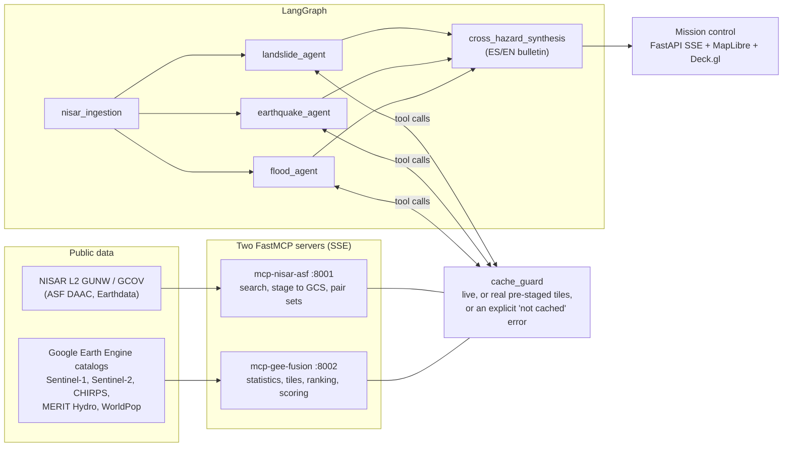

# BailaSAR: NISAR L-band observatory for cascading disasters in Colombia

BailaSAR is a hackathon project for the NASA Space Apps challenge **"Dancing with the SARs"**, built in Medellín to investigate cascading disasters in Colombia using public radar observations and contextual datasets. Its intended focus is landslides in the Aburrá Valley, earthquake damage assessment and first-aid ranking in the Eje Cafetero, and flooding at La Mojana / Caregato. The goal is to make surface-change evidence understandable through a mission-control map and tool-grounded bulletins; the status below distinguishes available discovery evidence from analysis and demo features still pending integration.

> **Evidence rules.** No synthetic or fabricated data. Missing pixels and bands remain missing (NaN, shown as "no data"), never zero-filled. Measured results require the producing command, source granule or scene IDs, denominators and applicable intervals; estimates must be labelled. Agents write prose with `{placeholders}` filled from tool outputs. Only public data is permitted; no personal data or secrets. See [AGENTS.md](AGENTS.md).

## Quickstart

Use a local checkout with [uv](https://docs.astral.sh/uv/), Bash and GNU make. Docker with Compose is needed for the stack targets. Read the limitations below before attempting the offline demo.

### Setup

```bash
make setup
```

This installs the project environment and commit hooks, creates `.env` from [.env.example](.env.example) if absent, and creates `local_cache/`. Keep credential values in the ignored local `.env` only.

### Offline demo from a release cache (pending)

The intended submission workflow is:

```bash
export BAILASAR_REPO="<owner/repository>"
export BAILASAR_RELEASE_TAG="<published-release-tag>"
make fetch-cache
make pitch
```

**Currently blocked:** `make fetch-cache` now downloads and verifies release assets (#67), but no submission release or downloadable cache has been published yet. The repository and tag above are placeholders for the team's published release, not working download coordinates. Do not run this sequence expecting a complete demo yet. The planned release must contain real tiles, statistics and a provenance manifest with source IDs; `local_cache/` stays out of git.

`make pitch` selects the offline Compose profile at <http://localhost:8000>. End-to-end offline operation is pending. The current Compose configuration also expects local credential mount paths and invokes the cache warmer when its manifest is absent; selecting pitch mode alone does not establish a credential-free offline demo.

### Live mode (credentials required)

Configure the relevant keys from [.env.example](.env.example): Earthdata authentication for ASF/NISAR; a Google Cloud project and storage bucket plus authorized Earth Engine/Google Cloud credentials; and a configured LLM provider key for bulletin generation. Use the team's approved authentication setup; do not paste credential values into docs, logs or chat.

```bash
make up
```

This starts the live Compose profile at <http://localhost:8000>. Live hazard analysis remains pending integration; a launch command is not evidence of a working pipeline. Cloud processing is restricted to the account holders named in [AGENTS.md](AGENTS.md).

### Windows notes and commands without make

Use Git Bash for the Makefile's Bash syntax. Git Bash, uv and GNU make are separate prerequisites; Windows does not include uv or make by default, and Git Bash does not supply GNU make by itself. With uv installed, run the commands behind the development targets directly from the repository root:

```bash
# make setup
uv sync --all-extras
uv run pre-commit install --hook-type pre-commit --hook-type commit-msg
[ -f .env ] || cp .env.example .env
mkdir -p local_cache

# make check
uv run pre-commit run --all-files

# make test
uv run pytest -q -m "not network and not cache"

# make up (requires credentials)
OFFLINE_DEMO_MODE=0 docker compose --profile live up --build -d

# make pitch (requires a real cache; integration pending)
OFFLINE_DEMO_MODE=1 docker compose --profile pitch up -d
```

Without make, run `scripts/fetch_cache.sh` with the same two variables. Stack targets wrap Docker Compose rather than uv. See the [Makefile](Makefile) for the remaining commands and [AGENTS.md](AGENTS.md) for contributor checks and worktree rules.

## Status

States: **live** · **cached** · **not cached** · **planned** · **dropped**. Discovery evidence does not demonstrate that a hazard pipeline or the offline demo works. Pending rows retain the scope of the existing rewrite; no completed integration is claimed without evidence.

| Component | State | Issue / PR | Report |
|---|---|---|---|
| NISAR discovery gate (search script and saved catalog) | live | #23 | [Gate report](reports/gate.md) |
| Pre-registration and power check (fields pending) | planned | #25 | pending |
| Quake damage proxy (track 11; C-pass statistics withheld until the pre-registration freeze, see [deviation 1](validation/README.md#deviations)) | cached | #31, #64 | pending |
| First-aid ranking and scorecard (offline logic implemented; real-data integration pending) | planned | #18, #32 | [Scoring API and fixtures](validation/ALLOWLIST.md) |
| Aburrá landslide noise-floor test | planned | — | pending |
| La Mojana flood classes (dual-pol HH/HV) | planned | — | pending |
| Sentinel-1/2 curtain-slider tiles (3 AOIs, rule-selected scenes) | cached | #30, #65 | `local_cache/<aoi>/tiles/manifest.json` |
| NISAR real-data cache (3 AOIs) | planned | #30 | pending |
| Release staging and `make fetch-cache` (no release yet) | live | #42, #67 | pending |
| MCP servers and SSE integration | planned | #10 | pending |
| LangGraph orchestrator and bulletin integration | planned | #11, #51 | pending |
| Local Zarr tile server | not cached | #22 | Shared cube and manifest required for the LOS layer |
| Mission-control UI, curtain slider and story map | not cached | #22, #37 | Approved chapter outputs and comparison tiles required; offline staging in [frontend status](status/frontend-video.md) |
| Submission video | planned | — | pending |
| Biomass agent (TODO; out of scope) | dropped | — | — |
| GOFF / surface-rupture analysis (TODO; out of scope) | dropped | — | — |
| Split-spectrum ionosphere processing (TODO; out of scope) | dropped | — | — |
| GEE High-Volume endpoint (TODO; out of scope) | dropped | — | — |
| `/math-lab` | dropped | #41, #55, #56 | — |
| ISRO S-band fusion (TODO; out of scope) | dropped | — | — |

## Results

`validation/scoring.py` supplies tested offline scoring functions. Callers must
provide approved frozen settings and accepted real observations. Passing logic
tests does not establish a real-data scorecard or a radar advantage.

See `reports/` — pending.

- Quake scorecard and population-only comparison: see `reports/` — pending.
- Aburrá motion or documented null: see `reports/` — pending.
- La Mojana flood classes and sensitivity: see `reports/` — pending.
- Offline demo and tool latency evidence: see `reports/` — pending.

## Architecture

The retained diagram describes the agreed architecture, not a claim of completed integration. Biomass is outside the submission scope.



- **Quake:** planned coherence-loss damage proxy over built-up pixels, with first-aid ranking compared against a population-only baseline and a pre-event control. Pre-registration remains pending in [validation/README.md](validation/README.md); it must be committed before co-event coherence is viewed.
- **Aburrá landslides:** planned use of GUNW unwrapped phase and the supplied ionosphere screen, subject to layer availability and a stable-pixel noise-floor check. A null result must be reported when motion is unsupported. Split-spectrum ionosphere estimation is out of scope.
- **La Mojana flood:** planned dual-pol HH/HV change detection against a dry baseline, with height-above-drainage gating. Classification thresholds belong in config and require validation.
- **Agents route, tools compute:** numeric bulletin content must come from deterministic tool outputs or sourced event constants in [validation/event_facts.json](validation/event_facts.json). AI-written bulletins must carry the **SI-Assisted Analytics** badge; enforcement remains part of the pending integration.
- **Cache guard:** the agreed fallback serves only real pre-staged tiles with provenance, or an explicit "not cached" error. The breaker default in [config/bailasar.yaml](config/bailasar.yaml) is a configuration estimate, not a measured latency result. Per-tool measurements are pending.
- **Panel states:** the required UI states are live, cached, not cached, gate result or error. Missing data must be explicit.

Frozen thresholds, ranking parameters and pair choices belong only in [config/preregistered.yaml](config/preregistered.yaml); operational settings belong in [config/bailasar.yaml](config/bailasar.yaml). The design and binding decisions are in [docs/designs/bailasar.md](docs/designs/bailasar.md). Biomass, GOFF/rupture, split-spectrum ionosphere and GEE High-Volume remain out of scope / TODO even where imported baseline code still mentions them.

## Data sources and citations

Only public inputs are permitted. The datasets below are the intended inputs, not evidence that each has already been ingested. Cached outputs must retain source granule or scene IDs and provenance. Official provider links are included only where already referenced in the repository; other entries name the dataset and provider pending source verification. No DOI is inferred.

| Dataset | Provider / citation | Intended role |
|---|---|---|
| NISAR L-band GUNW / GCOV | NASA/JPL and ISRO; distributed by [ASF DAAC](https://asf.alaska.edu/notices/nisar-l-band-data-now-publicly-available/); [ASF GUNW documentation](https://nisar-docs.asf.alaska.edu/gunw/) | Coherence, unwrapped phase and HH/HV backscatter |
| Sentinel-1 | ESA / Copernicus | C-band comparison and water context |
| Sentinel-2 | ESA / Copernicus | Optical comparison |
| CHIRPS | Climate Hazards Center, University of California, Santa Barbara | Precipitation and wetness context |
| FABDEM | University of Bristol | Terrain context |
| MERIT Hydro | University of Tokyo, Institute of Industrial Science | Drainage context and flood gating |
| JRC Global Surface Water | European Commission, Joint Research Centre | Surface-water history |
| WorldPop | WorldPop, University of Southampton | Population exposure and baseline ranking |
| OpenStreetMap | OpenStreetMap contributors | Public hospitals and roads; extract provenance required |
| Published damage reports | Issuing public agency and report citation pending selection in [validation/README.md](validation/README.md) | Independent damage labels for scoring |

The NISAR references above are already recorded in [docs/kb/](docs/kb/). Dataset and method claims require primary-source verification there before they can support the pitch.

## Acknowledgements and agency credits

NASA/JPL and ISRO are NISAR mission partners; ASF DAAC distributes its L-band products. ESA and Copernicus provide Sentinel observations. Google Earth Engine supplies catalog access and computation. We acknowledge the Space Apps organizers and the Medellín local event.

Use no NASA logos, flags or identifiers in generated media, badges or UI headers, and no likeness of minors. Agency names here provide attribution and do not imply endorsement.

## AI disclosure

This project is built with Claude Code + gstack, OpenAI Codex, Google Antigravity/Gemini, OpenCode (GLM), Grok and LangGraph.

The team reviews AI-assisted code and documentation. The initial generated baseline is documented in [docs/baseline/BASELINE_NOTES.md](docs/baseline/BASELINE_NOTES.md). Runtime bulletin generation is subject to the tool-output and disclosure requirements above. Disclosure of any AI tools used in the submission video is pending completion of that artifact.

## License

License: to be decided by the team (TODO)

## Team

| Team member | Lane |
|---|---|
| [@LEONOB2014](https://github.com/LEONOB2014) | orchestrator, data gate, hazard modeling |
| [@Jack4Codes](https://github.com/Jack4Codes) | config, pre-registration, cloud tools |
| [@Maru816](https://github.com/Maru816) | scoring and ground truth |
| [@EstebanOchoaedos](https://github.com/EstebanOchoaedos) | knowledge base, cloud cache checks, README |
| [@alicealanapineda-byte](https://github.com/alicealanapineda-byte) | MCP, agents, bulletin |
| [@SaritaRpo](https://github.com/SaritaRpo) | UI and video |
