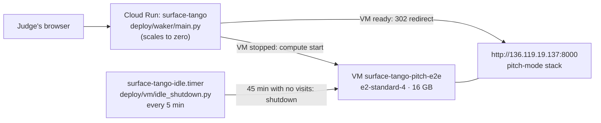

# Hosting through the judging period (Google Cloud)

Space Apps judges evaluate projects for about two months after the hackathon, so the
observatory stays reachable until **2027-01-31**. As the team agreed, the demo VM has
**16 GB of RAM** and **starts on request**: the first visit wakes it, and it powers itself
off when nobody uses it. This page is the runbook for that period.

**Code freeze:** no code changes after **2026-11-15 23:59 (Bogotá)**. During judging,
only cloud operations (start, stop, budget, access) are allowed. A redeploy that would
change the submitted code is not.

## Public URL

**<https://surface-tango-827987874406.us-central1.run.app/>**: give judges this one, not the
VM's IP. If the VM is running, it redirects straight to the app. If the VM is stopped, it
starts it and shows a two-feet waiting page that opens the app by itself once it answers.

## How it works



- **Front door** (`deploy/waker/`): Cloud Run service `surface-tango` in `us-central1`. It
  runs as `bailasar-runtime`, which has `roles/compute.instanceAdmin.v1` on **this one
  instance only**, and is public (`--allow-unauthenticated`), with min 0 and max 2
  instances. It probes the app with `/assets/mission-control.css`. `/status` returns the VM
  state, and the waiting page polls it every 4 s.
- **Idle shutdown** (`deploy/vm/`): a systemd timer runs `idle_shutdown.py` 5 min after boot
  and then every 5 min. The script powers the VM off when the web container logged no
  request for `/` or `/api/…` in the last **45 min**. It never does so in the first
  20 min after boot, or while the web container is down. Front-door probes never count as
  visits. The frontend does not poll, so an open but unused tab does not keep the VM awake.

## What runs

| Item | Value |
|---|---|
| Project | `loyal-curve-472605-g7` |
| VM | `surface-tango-pitch-e2e`, zone `us-central1-a`, **e2-standard-4** (4 vCPU, 16 GB), standard provisioning (not spot), deletion protection on |
| External IP | static `surface-tango-web-ip` (136.119.19.137), unchanged across stop/start |
| Stack | `/opt/surface_tango` on the VM: a `git archive` of `main` at `3568651`, run with `OFFLINE_DEMO_MODE=1 docker compose --profile pitch up -d`. Containers use `restart: unless-stopped` and Docker starts at boot, so the stack returns on every wake |
| Cache | `/opt/surface_tango/local_cache`: copied from the earlier deployment, plus `mojana/flood_evidence.json` and the eight `frontend-assets` files `app.py` serves at `/assets/` (MapLibre 4.7.1, deck.gl 9.0.34, `mission-control.css`, `@fontsource/jost` and `@fontsource/libre-caslon-text` 5.1.1) |
| Rollback | the image that ran before 2026-11-15 is tagged `sars-dance-medellin:pre-main-backup` |
| Ingress | firewall rule `surface-tango-web-8000`: tcp:8000 from anywhere to tag `surface-tango-web`. Ports 8001/8002 are not open |
| Logs | with this branch's `docker-compose.yml`: json-file, 10 MB × 3 per container |

Pitch mode serves the staged cache and the hashed LLM cache, so visits do not start Earth
Engine jobs.

## Measured on 2026-11-15

- **Memory:** after 8 h on e2-standard-4 the host used 1,558 of 15,985 MB, and the
  containers used 537 + 144 + 71 MiB (`free -m`, `docker stats --no-stream`).
- **App smoke test** (after the redeploy of `main`, `curl` on the VM): these returned 200:
  `/`, `/api/pitch-facts`, `/api/bulletin`, `/api/flood-series`,
  `/api/landslide-verdict`, `/api/cache-bands/mojana`, `/api/sentinel-tiles/mojana`,
  `/api/flood-mask?date=2026-06-17` and every `/assets/` file. `/api/panel-gate/*`
  returned 204. `/api/story-results` returned 404 ("Approved story results not staged":
  no approved story file is in the cache). From outside, `:8000` answered and
  `:8001`/`:8002` timed out.
- **Cold start:** with the VM stopped, a `curl` loop on `/status` measured the front door at
  PROVISIONING after 3 s, RUNNING after 23 s and app ready after **60 s**
  (n = 1). A browser opened on the front door showed the waiting page and handed itself
  off to the app with no click. Warm visits are redirected with a 302.

## Cost for the period *(estimate)*

Google Cloud list prices for `us-central1`, USD. These are not measured; check real spend
in **Billing → Reports**.

| Item | Rate | Bills |
|---|---|---|
| e2-standard-4 | ≈ 0.134 / h | only while running |
| 50 GB pd-balanced disk | ≈ 5.0 / month | always |
| Static IPv4 | ≈ 0.005 / h in use, ≈ 0.01 / h while the VM is stopped | always (≈ 4–7 / month) |
| Cloud Run front door | free tier at judging traffic | per request |

The fixed floor is ≈ USD 12/month. Each wake costs at least ≈ 65 min of VM time (the visit
plus the 45-min idle tail plus boot), about USD 0.15. Even if the VM ran 24/7 until
2027-01-31 it would cost ≈ USD 270, within the budget. On request, the expected cost is a
small fraction of that.

## Budget

The billing budget **"Surface Tango hackathon + evaluation (~USD 300)"** is
**949,000 COP** (the billing account bills in COP; ≈ USD 300) over a custom period
**2026-11-01 → 2027-01-31**, for this project only. It e-mails billing admins at 25 %,
50 %, 75 %, 90 % and 100 % of actual spend. (Custom-period budgets do not accept
forecast-based alerts.) A budget only alerts; it never stops anything.

## Operating it

```bash
# State of the VM (TERMINATED between visits is normal)
gcloud compute instances describe surface-tango-pitch-e2e --zone us-central1-a --format="value(status,machineType.basename())"

# Wake it without a browser
curl -s https://surface-tango-827987874406.us-central1.run.app/status

# Idle-timer log on the VM
gcloud compute ssh surface-tango-pitch-e2e --zone us-central1-a --command "journalctl -u surface-tango-idle --since -2h --no-pager | tail"

# Keep the VM up for a live session (e.g. a judges' call): pause the timer, resume after
gcloud compute ssh surface-tango-pitch-e2e --zone us-central1-a --command "sudo systemctl stop surface-tango-idle.timer"
gcloud compute ssh surface-tango-pitch-e2e --zone us-central1-a --command "sudo systemctl start surface-tango-idle.timer"

# Redeploy the front door (ops only; not after the code freeze unless the code is unchanged)
cd deploy/waker && gcloud run deploy surface-tango --source . --region us-central1 --service-account bailasar-runtime@loyal-curve-472605-g7.iam.gserviceaccount.com --allow-unauthenticated --min-instances 0 --max-instances 2 --memory 256Mi --set-env-vars GCP_PROJECT_ID=loyal-curve-472605-g7,VM_ZONE=us-central1-a,VM_NAME=surface-tango-pitch-e2e,VM_PORT=8000
```

The idle timer was installed on the VM by copying `deploy/vm/idle_shutdown.py` to
`/opt/surface_tango/deploy/vm/` and the two unit files to `/etc/systemd/system/`, then
running `systemctl enable --now surface-tango-idle.timer`.

## Shutting it down after judging

1. Delete the Cloud Run service `surface-tango` (region `us-central1`).
2. Turn deletion protection off (`gcloud compute instances update surface-tango-pitch-e2e --zone us-central1-a --no-deletion-protection`), then delete the VM.
3. Release the static IP (`gcloud compute addresses delete surface-tango-web-ip --region us-central1`); an unattached static IP still bills.
4. Delete the firewall rule `surface-tango-web-8000`.
5. Leave the budget in place until the last invoice closes.
